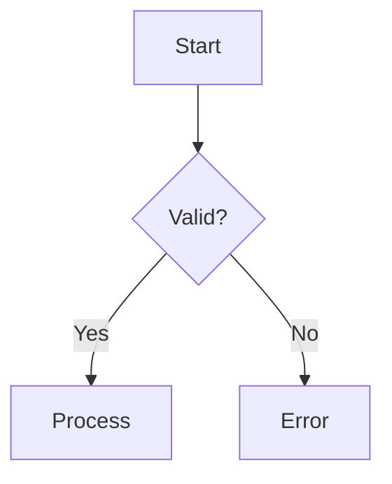

# ViewMD User Guide

This guide is for developers using ViewMD to view, navigate, and export Markdown files.

## 1. Opening Markdown Documents

ViewMD integrates seamlessly into the standard editor:
- Open any `.md` or `.markdown` file.
- Toggle between **Editor**, **Preview**, or **Split Mode** using the editor top-right toolbar.
- Scroll synchronization tracks your cursor position bidirectionally between code and preview.

## 2. Table Controls

- **Horizontal Scrolling**: Wide tables scroll sideways within their container without clipping.
- **Sticky Headers**: Column headers stay pinned at the top while scrolling vertically through large data sets.
- **Copy Toolbar**: Hover over any table to reveal the action toolbar:
  - **Copy Markdown**: Copies the clean GFM table markup.
  - **Copy TSV**: Copies tab-separated values ready for pasting into Google Sheets or Excel.

## 3. Front Matter Cards

When a document begins with a YAML block (`---`), ViewMD condenses it into a metadata card:
- Displays `summary` as body text.
- Formats `triggers` as interactive visual chips.
- Flags unindexed documents (`index: false`) with a badge.
- Shows any syntax warnings if YAML is malformed while keeping document content readable.

## 4. Offline Diagrams

### Mermaid
```markdown

```

### PlantUML
```markdown
```plantuml
Alice -> Bob: Offline Authentication
Bob --> Alice: Success
```
```

## 5. Custom CSS & Live Reload

1. Open `Settings > Tools > ViewMD`.
2. Select your custom stylesheet (`.css`).
3. ViewMD checks permissions, file size, and path resolution immediately in the diagnostics panel.
4. Any edits saved to the CSS file are applied instantly via the Virtual File System watcher.

## 6. Exporting

Right-click anywhere in a Markdown file to access the **ViewMD** context menu:
- **Open Preview in Browser**: Creates a standalone temporary HTML page and launches your system browser.
- **Export as HTML...**: Saves a self-contained HTML document with inlined offline styles and diagram renderers.

## 7. IDE Integration & External Browser Cleanliness

- **IntelliJ IDEA Command Runner**: In IntelliJ IDEA, runnable code blocks (`bash`, `sh`, etc.) can execute directly inside the IDE's Terminal via IntelliJ's native gutter/preview runner.
- **Zero Broken Artifacts in Browsers**: When using **Open Preview in Browser** or **Export as HTML...**, IDE-specific execution anchors, internal relative image assets (`commandRunner/*.png`, `alertIcons/*.png`), and duplicate buttons are automatically sanitized into clean, self-contained HTML. Exported documents never show broken image icons or dead `#` anchor jumps.

