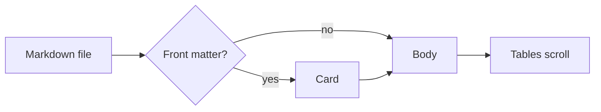
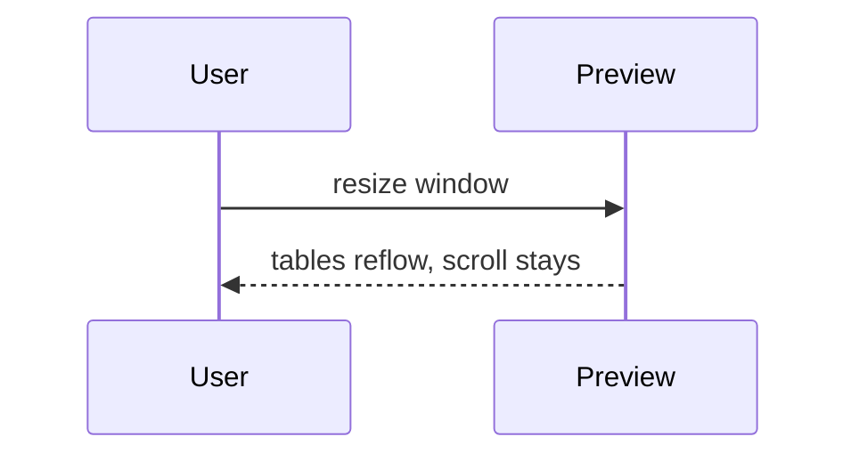
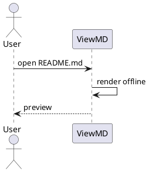

# ViewMD torture test

Open this file in every phase. Resize the window to 400, 900 and 1600 px and switch light/dark. Each section says what
"correct" looks like.

## 1. Wide table (12 columns, long text)

Correct: scrolls horizontally inside the table, header stays visible, no column narrower than ~12 characters, no
letter-per-line wrapping.

| ID | Area | Requirement | Owner | Status | Priority | Ticket | Risk | Evidence | Notes | Last update | Next step |
|---|---|---|---|---|---|---|---|---|---|---|---|
| R-001 | Tables | Wide tables scroll horizontally instead of squeezing columns into one-letter lines | Mina | In progress | P0 | TM-19602 | Medium: depends on CSS specificity in the stock preview | `docs/images/baseline/wide-900.png` | Verified in Android Studio 2026.2.2 sandbox with a 12 column fixture and a long paragraph in every cell to force wrapping | 2026-11-10 | Add the sticky header and capture the 400 px screenshot |
| R-002 | Front matter | Render `summary` as text and `triggers` as chips in a collapsed card | Mina | Not started | P0 | TM-19603 | Low | n/a | Invalid YAML must show a warning and still render the body | 2026-11-10 | Write the parser spike |
| R-003 | Diagrams | Mermaid and PlantUML render offline | Mina | Not started | P0 | TM-19604 | High: PlantUML may need Graphviz | n/a | Compare in-process jar vs the IDE plugin | 2026-11-10 | Spike C |

## 2. Narrow table

Correct: natural width, not stretched to the full content width.

| Key | Value |
|---|---|
| a | 1 |
| b | 2 |

## 3. Alignment, inline code, links, escaped pipes, line breaks

| Left | Center | Right |
|:---|:---:|---:|
| `inline code` | [a link](https://example.com) | 1,234.50 |
| escaped \| pipe | line<br>break | **bold** and _italic_ |
| `a \| b` in code | ~~strike~~ | 99% |

## 4. Long unbreakable tokens in cells

Correct: tokens wrap inside the cell (`overflow-wrap:anywhere`) and never push the table wider than it should be.

| Kind | Value |
|---|---|
| URL | https://thrivemarket.atlassian.net/wiki/spaces/TECH/pages/4888788998/Prism+Architecture+Design+Reference?focusedCommentId=123456789 |
| SHA-256 | 3a7bd3e2360a3d29eea436fcfb7e44c735d117c42d1c1835420b6b9942dd4f1b |
| Path | thrive-market-app/app/src/main/java/com/thrivemarket/app/feature/checkout/presentation/viewmodel/CheckoutViewModel.kt |

## 5. Table with many short columns (20)

| a | b | c | d | e | f | g | h | i | j | k | l | m | n | o | p | q | r | s | t |
|---|---|---|---|---|---|---|---|---|---|---|---|---|---|---|---|---|---|---|---|
| 1 | 2 | 3 | 4 | 5 | 6 | 7 | 8 | 9 | 10 | 11 | 12 | 13 | 14 | 15 | 16 | 17 | 18 | 19 | 20 |

## 6. Mermaid





## 7. PlantUML



An intentionally broken one (must show an error box plus the source, no crash):

```plantuml
@startuml
this is not valid ->-> plantuml
```

## 8. Alerts, task lists, footnotes, details

> [!NOTE]
> Useful information.

> [!WARNING]
> Urgent info that needs attention.

- [x] done item
- [ ] open item
  - [ ] nested open item

Footnote reference.[^1]

[^1]: The footnote text.

<details>
<summary>Click to expand</summary>

Hidden **markdown** content with a table:

| a | b |
|---|---|
| 1 | 2 |

</details>

## 9. Code

```kotlin
data class FeatureUiState(val isLoading: Boolean, val errorMessage: String?)
```

```diff
- old line
+ new line
```

```bash
./gradlew :app:testDebugUnitTest --tests "com.thrivemarket.app.feature.ClassNameTest"
```

A very long single line in a fence must scroll inside the block, not the page:

```text
this_is_a_very_long_line_without_any_spaces_to_check_that_code_blocks_scroll_horizontally_and_do_not_widen_the_page_0123456789_0123456789_0123456789_0123456789_0123456789_0123456789
```

## 10. Math

Inline $E = mc^2$ and block:

$$
\int_0^\infty e^{-x^2}\,dx = \frac{\sqrt{\pi}}{2}
$$

## 11. Links and images

- Relative file link: [the plan](../PLAN.md#phase-1-web-layer-and-tables-the-core-fix)
- In-page anchor: [back to the top](#viewmd-torture-test)
- External: [JetBrains](https://www.jetbrains.com)
- Relative image (add one under `docs/images/` when available): ``
- Remote image (must be blocked by default): ``

## 12. Security fixtures (must be neutralised, never executed)

<script>document.title = "pwned";</script>


[click](javascript:alert(1))

<iframe src="https://example.com"></iframe>

## 13. Deep nesting and long lists

1. One
   - Two
     1. Three
        - Four
          - Five

> Quote level 1
>
> > Quote level 2
> >
> > > Quote level 3

---

Final paragraph with a very long unbreakable string: aaaaaaaaaaaaaaaaaaaaaaaaaaaaaaaaaaaaaaaaaaaaaaaaaaaaaaaaaaaaaaaaaaaaaaaaaaaaaaaaaaaaaaaaaaaaaaaaaaaaaaaaaaaaaaaaaaaaaaaaaaaaaaaaaaaaaaaaaaaaaaaaaaaaa
