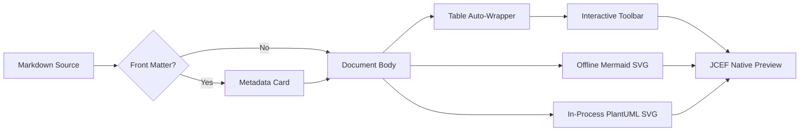
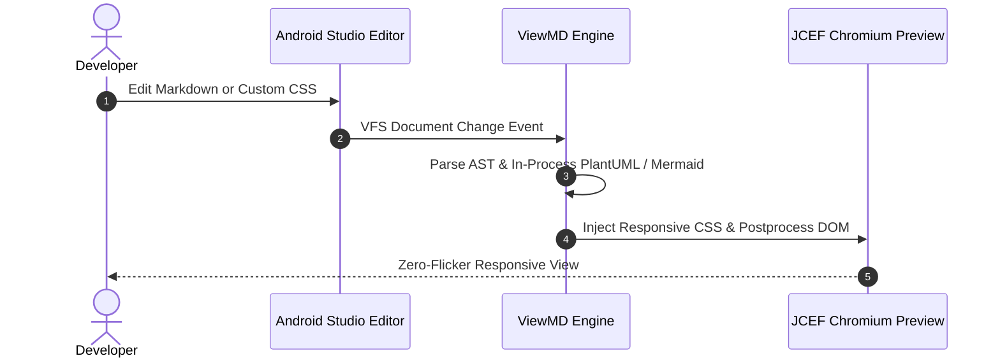
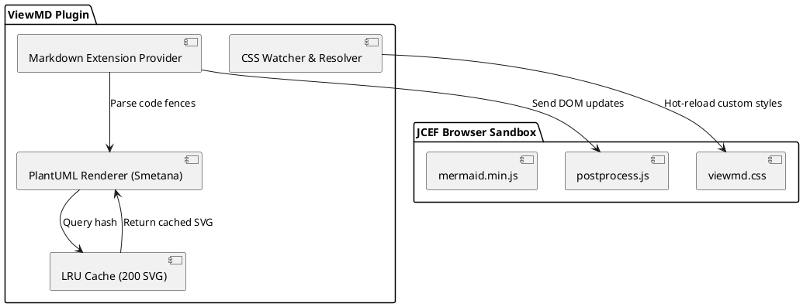

# ViewMD Showcase & Capabilities Guide

Welcome to **ViewMD** — the professional-grade Markdown preview engine built specifically for **Android Studio** and **IntelliJ-based IDEs**. ViewMD transforms static Markdown rendering into a responsive, offline-first developer workspace.

---

## 1. Feature Comparison & Capability Matrix

Wide tables with extensive columns automatically scroll smoothly inside an overflow container with pinned column headers and readable column widths. Hover over the table to reveal the **Copy Markdown** and **Copy TSV** export toolbar.

| Capability | ViewMD | Stock IDE Preview | Third-Party Plugins | Offline Engine | Memory & CPU Safety | Android Studio 2026.2+ | IntelliJ IDEA 2026.2+ | Export Fidelity | Production Status |
|---|---|---|---|---|---|---|---|---|---|
| **Responsive Table Scrolling** | Smooth horizontal scroll; zero squeezed single-letter columns | Columns squeezed to 1 letter per line | Often clips or overflows window | Pure Client CSS/JS (zero remote) | Zero memory leak; bounded DOM observer | Supported (Ladybug & Meerkat) | Supported (Community & Ultimate) | Standalone HTML with inlined styles | Verified (VMD-101) |
| **Table Action Toolbar** | Hover toolbar with 1-click Copy Markdown and Copy TSV | Not available | Not available | Pure Client DOM | Event listener leak guards with class locks | Supported | Supported | Preserved in external browser preview | Verified (VMD-102) |
| **YAML Front Matter Cards** | Interactive collapsible cards with trigger badges & status chips | Raw, unstyled code blocks at top of document | Often hidden or discarded | Pure Client DOM parser | Safe JSON serialization & HTML escaping | Supported | Supported | Exported with matching theme styling | Verified (VMD-103) |
| **Mermaid Diagram Engine** | Bundled offline Mermaid.js v10.9 with strict CSP isolation | Requires remote CDN or manual plugin install | Unbundled CDN downloads | 100% Bundled & Offline | Strict sandbox; no external requests | Supported | Supported | Inlined SVG in standalone exports | Verified (VMD-104) |
| **PlantUML Diagram Engine** | In-process PlantUML renderer powered by built-in Smetana engine | Requires external Graphviz binary installation | Requires external Graphviz | Built-in Pure Java Smetana | Thread-safe LRU cache bounded at 200 SVGs | Supported | Supported | Pre-rendered vector SVG export | Verified (VMD-105) |
| **Live Custom CSS Reload** | Diagnostics panel for `~`, relative & absolute paths with live reload | Frequently fails with "file not found" errors | Basic or no reload support | IntelliJ VFS AsyncFileListener | Auto-refreshed without IDE restart | Supported | Supported | Custom rules injected into export | Verified (VMD-106) |
| **Clean Standalone Export** | One-click HTML export sanitizing broken IDE runner anchors & alert icons | Basic export with broken runner anchors | Varies by plugin | Self-contained single-file HTML | Zero remote dependencies or CDN links | Supported | Supported | 100% clean standalone document | Verified (VMD-107) |

---

## 2. Compact Settings & Configuration

Narrow tables retain their natural width without artificial stretching across the preview pane:

| Setting Key | Default Value | Recommended Range | Description |
|---|---|---|---|
| `contentWidthPx` | `980` | `400` – `3840` | Default maximum reading width in pixels |
| `isFullWidth` | `false` | `true` / `false` | Expand preview to 100% of editor pane |
| `colMinChars` | `12` | `8` – `30` | Minimum column character width to prevent squeezing |
| `colFirstMinChars` | `14` | `10` – `40` | Minimum character width for the leading header column |
| `fontSizePx` | `15` | `10` – `40` | Base typography font size in pixels |
| `customCssPath` | `""` | Valid `.css` path | Optional custom stylesheet with live diagnostics |

---

## 3. Long Unbreakable Identifiers & Tokens

Long URLs, hashes, and package paths wrap safely inside cells without blowing out document bounds:

| Token Category | Identifier / Value | Wrap Behavior |
|---|---|---|
| **API Endpoint** | `https://api.viewmd.dev/v1/plugins/marketplace/verification/catalog/android-studio/meerkat?bundle=dev.mina.viewmd&build=2026.2.4` | Wraps inside cell without pushing table |
| **Git SHA-256** | `e3b0c44298fc1c149afbf4c8996fb92427ae41e4649b934ca495991b7852b855` | Breaks cleanly at cell boundaries |
| **Kotlin Package** | `dev.mina.viewmd.extensions.ViewMdBrowserPreviewExtension$Provider` | Preserves mono formatting |

---

## 4. 100% Offline Architecture Diagrams

### System Architecture Flowchart (Mermaid)



### Component Interaction Sequence (Mermaid)



### Rendering Pipeline (PlantUML)



---

## 5. Callouts & Information Alerts

> [!NOTE]
> ViewMD bundles all styling, fonts, and scripts directly inside the plugin archive. No remote HTTP or CDN requests are ever made.

> [!TIP]
> Press `Ctrl + Shift + X` (or right-click in editor) to export a standalone HTML document ready for client presentations.

> [!IMPORTANT]
> Compatible with Android Studio Ladybug, Meerkat, and IntelliJ IDEA 2026.2+ platforms.

> [!WARNING]
> When defining custom CSS, use CSS variables (such as `--viewmd-fg` and `--viewmd-bg`) to maintain seamless dark and light mode synchronization.

---

## 6. Code Blocks with Instant Copy

Code blocks feature automatic syntax highlighting, clean margins, and one-click copy buttons:

```kotlin
package dev.mina.viewmd.export

object HtmlUtils {
    @JvmStatic
    fun escapeHtml(str: String): String {
        return str.replace("&", "&amp;")
            .replace("<", "&lt;")
            .replace(">", "&gt;")
            .replace("\"", "&quot;")
            .replace("'", "&#39;")
    }
}
```

```bash
# Verify plugin against target IDE platform
./gradlew test
./gradlew clean buildPlugin
```

---

## 7. Mathematics & Formula Rendering

Inline formulas like $E = mc^2$ and standalone mathematical equations render with clean typography:

$$
\mathcal{L}_{ViewMD} = \sum_{i=1}^{N} \left( \text{Readability}_i + \text{Responsiveness}_i \right)
$$

---

## 8. Verification & Release Checklist

- [x] Responsive table horizontal scroll active
- [x] Sticky table headers pinned on vertical scroll
- [x] Quick Copy Markdown and TSV buttons operational
- [x] Collapsible YAML front matter metadata cards rendered
- [x] 100% offline Mermaid flowchart and sequence diagram rendering
- [x] In-process PlantUML vector SVG rendering with LRU caching
- [x] Standalone HTML export sanitization verifying zero broken anchors
- [x] Complete test coverage across Kotlin unit tests and Playwright browser suites

